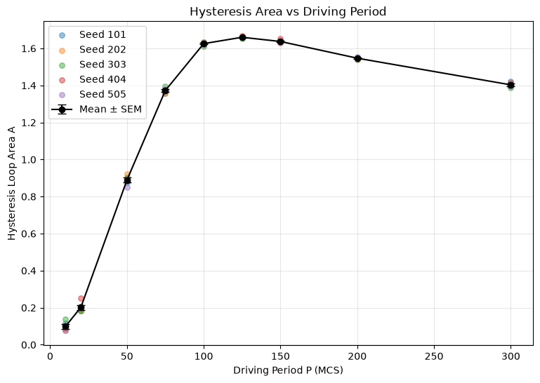
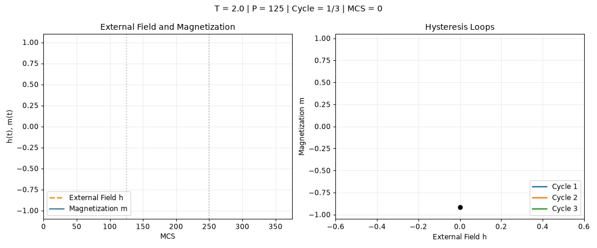
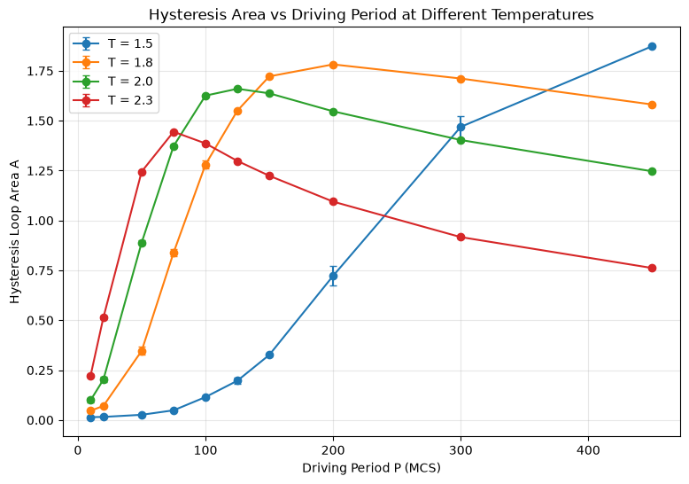
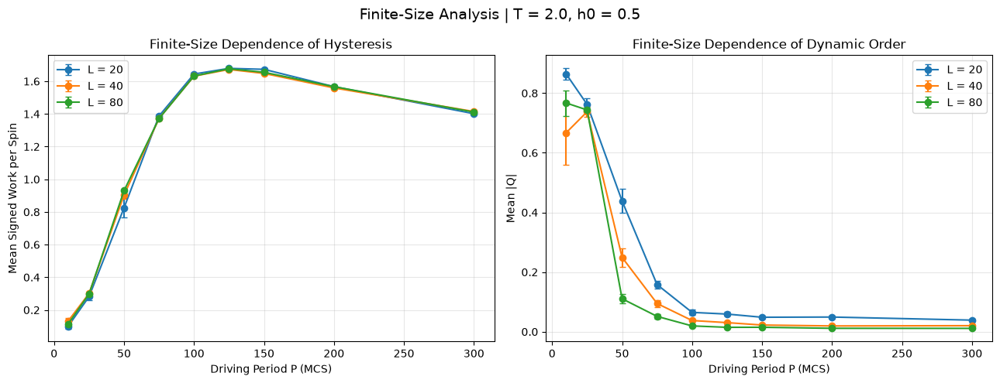

# Driven 2D Ising Model

**Fengrui Yang** · Undergraduate Computational Physics Research · November 2026

**What happens when a magnetic field reverses before a magnet has enough time to follow it?**

In these simulations, rapid driving can leave the magnetization biased toward one direction over the observed time window. Slower driving gives the spins time to reverse, tracing hysteresis loops as their response lags behind the field. This project follows that competition across driving periods, temperatures, and lattice sizes.

**[Read the full Research Note (PDF)](paper/research_note.pdf)**  
[Animation gallery](assets/demos/notebook/README.md) · [Original research notebook](notebooks/Simulator.ipynb) · [Numerical validation](docs/validation_status.md)

## How does the system respond to different driving periods?

At `T=2`, `L=40`, and field amplitude `h0=0.5`, the hysteresis response grows and then decreases as the period increases, with a sampled maximum near `P=125` Monte Carlo sweeps. Intermediate driving allows substantial magnetization reversal while retaining a strong lag behind the field. The note also checks this trend using signed field work.



*Figure 6 from the final paper: absolute trapezoidal loop integral, individual seeded results, and ensemble mean ± standard error.*

Watch three cycles at `P=125`:



Compare [fast driving at P=10](assets/demos/notebook/multi_cycle_hysteresis_P10.md) with [P=300](assets/demos/notebook/multi_cycle_hysteresis_P300.md), or [browse all eight animations](assets/demos/notebook/README.md). These demonstrations illustrate the dynamics alongside the quantitative paper figures.

## How does temperature change the hysteresis response and dynamic order?

Lower temperatures shift the strongest hysteretic response toward longer periods. The extended `T=1.5` scan reaches its sampled maximum near `P=600`. Lower-temperature runs also retain a larger cycle-averaged magnetization over a wider range of periods. A slower reversal process is a plausible explanation; its characteristic timescale was not measured directly.



*Figure 12 from the final paper: the absolute hysteresis integral at four temperatures. The extended low-temperature scan and dynamic-order comparison appear in Figures 13–14.*

[Explore the multi-temperature animation](assets/demos/notebook/multi_temperature_period_explorer.md).

## How does lattice size affect the observed behavior?

Across `L=20,40,80`, signed work follows a broadly similar period dependence, while the mean absolute dynamic order `⟨|Q|⟩` changes more strongly with size. Follow-up runs at `P=50` support the observed finite-time size dependence. Three sizes and finite observation windows do not determine the infinite-size or infinite-time limit.



*Figure F1 from the final paper: signed work per spin and mean absolute cycle-averaged magnetization. Error bars are standard errors across independent seeds.*

## Explore and reproduce

The three static figures above are [unaltered image extractions from the final PDF](assets/figures/README.md). The [25-cell research notebook](notebooks/Simulator.ipynb) remains the original research record. A reusable simulator and a focused reproduction script accompany it:

```sh
python -m venv .venv
source .venv/bin/activate
pip install -r requirements.txt
python -m unittest discover -s tests -v
python scripts/reproduce_period_scan.py --mode smoke --output results/period_scan_smoke
```

See [reproduction instructions and recovered settings](docs/reproducibility.md) for the full period scan. The [numerical validation documentation](docs/validation_status.md) records what the checks support and where sampling remains inconclusive, including very fast driving. Absolute loop integrals, signed field work, and dynamic order retain their distinct definitions.

## Project origin

This work grew from a collaborative UC Berkeley Physics 77 capstone and a shared Ising simulation baseline, followed by my own extensions into temperature, finite size, and numerical reliability. AI assistance supported coding, debugging, visualization, and editing. See [provenance and reuse](docs/provenance.md); no software license has been selected pending review of the collaborative code's ownership and reuse rights.

## Author's Note

I have to admit that this project has grown far beyond what I initially expected. What began as an investigation of how the driving period affects magnetization gradually led me to questions about temperature, finite-size effects, and eventually the reliability of the numerical methods themselves.

During the investigation, I encountered many interesting questions that I could not fully answer within the scope of this note. In particular, I am interested in why a rapidly oscillating magnetic field appears to promote the development of strong magnetization under certain low-temperature conditions, and how the dynamic order parameter behaves as we approach larger lattice sizes.

I also realized that obtaining a numerical result and understanding how much we can trust it are two different problems. Some of the observations in this project remain inconclusive, and I would like to revisit them with better numerical methods and a more detailed investigation of spin configurations and domain growth.

For now, I hope this note serves as a record of both the results I obtained and the questions that emerged along the way.
