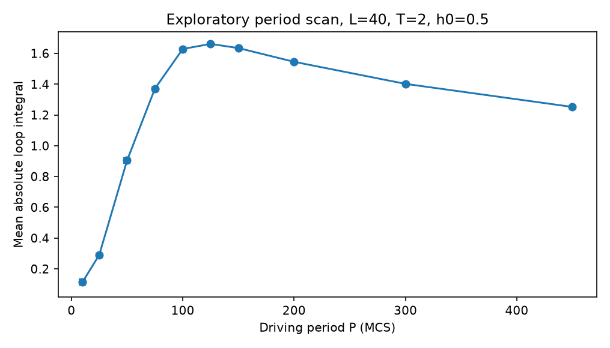
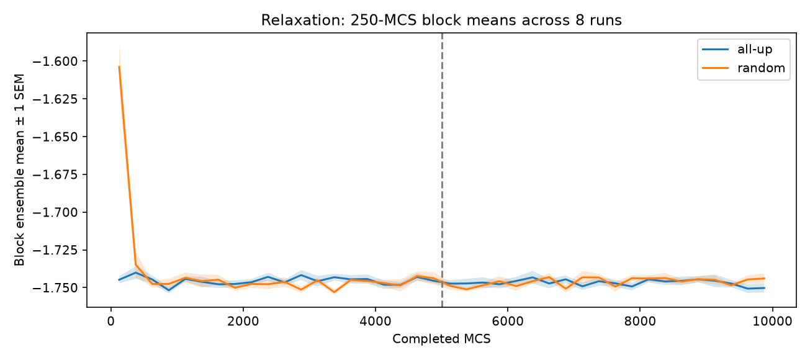

# Driven 2D Ising Model

**Magnetization dynamics and hysteresis under periodic magnetic driving**  
*A computational physics research portfolio in progress · Preliminary results · November 2026*

This project studies how a two-dimensional ferromagnetic Ising model responds to a time-dependent external magnetic field. We use **single-spin-flip Metropolis dynamics** to explore magnetization reversal, hysteresis, temperature dependence, and finite-size behavior. Numerical validation and the accompanying research note are **in progress**. Nothing shown here should yet be interpreted as proof of a dynamic phase transition or as a verified thermodynamic-limit result.

## All Simulator animations

**[Open the animation gallery — individual previews of all 8 GIFs](assets/demos/notebook/README.md)** — spin configurations, temperature response, all four hysteresis periods, period scanning, and multi-temperature playback. Each animation has its own preview page and downloadable GIF.

## Demo: three driving cycles


**Above:** the field and magnetization over three consecutive cycles (left), with evolving magnetization–field curves (right), at `L=40`, `T=2`, `h0=0.5`, `P=125` MCS. This GIF was generated by **the existing notebook's simulation and animation functions**, with seed `101` and 15 transient cycles omitted before the three displayed cycles. It is a qualitative demonstration, **not** a converged measurement of average dissipation.

Other actual animated demonstrations:

- [Three-cycle hysteresis at P=50](assets/demos/hysteresis_P50.gif)
- [Temperature comparison and field-step response](assets/demos/temperature_field_response.gif) — **field step**, not sinusoidal periodic driving

The legacy GIFs in `assets/demos/` and exploratory PNGs are **regenerated** by [`tools/generate_demo_assets.py`](tools/generate_demo_assets.py), calling the existing Metropolis core from the original notebook. Parameters and random seeds are fixed in that script; these are not necessarily pixel-identical copies of earlier exploratory screenshots. No synthetic example measurements replace simulation output.

## Research question and model

The key question is how the magnetization response changes with the external-field period, temperature, and lattice size. In the model, spins `sᵢ = ±1` reside on an `L × L` square lattice with periodic boundary conditions:

\[
H(t)=-J\sum_{\langle i,j\rangle}s_i s_j-h(t)\sum_i s_i,
\qquad h(t)=h_0\sin\left(\frac{2\pi t}{P}\right).
\]

The numerical convention is `J = kB = 1`, and **one Monte Carlo sweep (MCS) is `L²` attempted single-spin updates**, with the field evaluated once per sweep. Metropolis acceptance is `min(1, exp(-ΔE/T))`. MCS represents an algorithmic time scale, **not calibrated laboratory time**.

## Selected exploratory results

### Driving-period response



The regenerated period scan at `L=40`, `T=2.0`, `h0=0.5` explores the **mean absolute per-cycle loop integral** over three seeds, 24 cycles per seed, discarding eight initial cycles. Its trends remain preliminary. This is **preliminary**: the period dependence and precise peak require further burn-in, sampling, and observable-definition checks.

[See selected hysteresis loops](assets/results/selected_hysteresis_loops_preliminary.png)

### Temperature and lattice-size comparisons

| Explore | Existing figure | Interpretation status |
| --- | --- | --- |
| Different temperatures | [Period-by-temperature comparison](assets/results/temperature_period_scan_preliminary.png) | Exploratory; longer reversal times at lower temperature remain a hypothesis, not independently measured. |
| Different lattice sizes | [Finite-size comparison](assets/results/finite_size_scan_preliminary.png) | Exploratory; three sizes do not establish a thermodynamic limit. |

**Important observable caveat:** some early notebook cells calculate `mean(|∮ m dh|)` on individual cycles; other cells compute **signed work** `−∮m dh`, including from phase-averaged loops. These are **not interchangeable statistics**. The corresponding plots must not be combined into a single quantitative physical claim until the sign, quadrature, sampling time, and averaging conventions are standardized.

## Numerical validation — current evidence

At `L=40`, `T=2`, `J=1`, `h=0`, energy-relaxation runs compare **all-up** and **random** initial configurations. Eight runs per initial-state group are generated for 10,000 MCS each, with 5,000 MCS discarded. The earlier screenshot-derived estimates (`−1.7468`, `−1.7463`) are **not** results of these newly regenerated GitHub runs. The experiment examines **the energy observable only** for this parameter choice.



[Raw energy trajectories](assets/validation/01_raw_energy_L40_T2.png) · [Retained run means](assets/validation/03_retained_energy_L40_T2.png) · [Late-drift check](assets/validation/04_late_drift_L40_T2.png)

See [validation notes](docs/validation_status.md) for what was tested, what the figures support, and what remains open. The original validation screenshots were provided without their raw histories or generating notebook. The figures in this GitHub version are **freshly generated**, using the original Metropolis update function and a separate energy diagnostic. Their raw energy histories are available in [`results/validation_L40_T2_energy.npz`](results/validation_L40_T2_energy.npz).

## Code and demos

- [`notebooks/Simulator.ipynb`](notebooks/Simulator.ipynb): original Metropolis core, scans, and interactive demo source; outputs cleared for legibility. The two previously saved runtime errors are documented below, not silently treated as resolved.
- [`assets/demos/`](assets/demos/): README-ready exported GIFs.
- [`assets/results/`](assets/results/): existing exploratory simulation plots.
- [`assets/validation/`](assets/validation/): four actual energy-validation figures.
- [`paper/validation_draft.md`](paper/validation_draft.md): working prose for the first validation section, **not** a finalized paper.

### Run the notebook locally

```bash
python -m venv .venv
source .venv/bin/activate  # on macOS/Linux
pip install -r requirements.txt
jupyter notebook notebooks/Simulator.ipynb
```

Run the first code cell to define `simulator()` and the shared Metropolis core. Other exploratory cells build upon these definitions and, in some cases, variables created by earlier experiments. The original notebook includes interactive `ipywidgets` components, which **do not run on GitHub's static notebook preview**; open it locally in Jupyter. The GIFs render in this README. To regenerate the figures and energy histories, run `python tools/generate_demo_assets.py` from the repository root (CPU-intensive).

**Current notebook limitations:** two original analysis cells previously saved `SystemError` results, and the notebook has not been rerun and tested end-to-end in a clean environment. Notebook outputs were cleared; the code itself was **not rewritten or claimed to be fixed**. Some expensive parameter sweeps may take significant time. We plan to separate a reusable simulation core from analysis in a later cleanup.

## Open checks before final interpretation

1. Compare `|m(t)|` as well as energy across initial states, multiple temperatures and sizes; test burn-in and autocorrelation.
2. Benchmark zero-field equilibrium statistics against small-lattice exact enumeration and the Onsager–Yang magnetization result (with finite-size caveats).
3. Check **periodic steady state**, cycle-dependent work, seed variability, and time-discretization sensitivity under driving.
4. Use one consistent definition for hysteresis **signed work** versus absolute loop area; verify whether earlier plots need regeneration.
5. Preserve raw data, parameter manifests, code version, and uncertainties for each publication-quality figure.

## Project provenance and responsible use of tools

The starting point was a collaborative **UC Berkeley Physics 77 capstone project**, with **Group A** studying periodically driven Ising magnetization and a common Metropolis baseline developed within the class project. This repository is an evolving personal research/portfolio organization of the driven-response exploration; it **does not claim the shared group foundation as solely authored work**. AI assistance has been used for coding, explanations, plotting, and documentation. Scientific interpretation and numerical validation are being reviewed and refined; contributions will be made more specific before final publication. The original group proposal/checkpoint PDFs are **not redistributed** here.

No software license has been selected yet; please choose one before inviting reuse or contributions.
