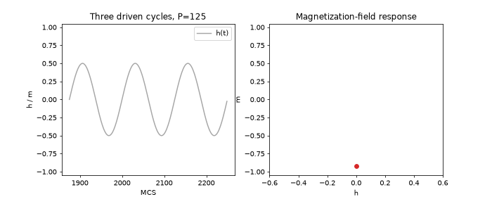

# Driven 2D Ising Model

**Nonequilibrium Dynamics of the Two-Dimensional Ising Model Under Periodic Magnetic Driving**  
**Fengrui Yang** · Undergraduate Computational Physics Research Note · November 2026

A computational study of magnetization, hysteresis, dynamic order, temperature dependence, and finite-size effects in the periodically driven two-dimensional Ising model. This repository connects the **research note**, the **Metropolis simulator**, its **numerical checks**, and **animated demonstrations**.

**Read the full research note:** [**Nonequilibrium Dynamics of the Two-Dimensional Ising Model Under Periodic Magnetic Driving (PDF)**](paper/research_note.pdf)  
[Latest simulator notebook](notebooks/Simulator.ipynb) · [Animation gallery](assets/demos/notebook/README.md) · [Numerical validation](docs/validation_status.md)

## Research question

How do the driving period `P`, temperature `T`, and lattice size `L` affect the response of the ferromagnetic Ising model to an oscillating magnetic field?

For spins `s_i = \pm1` on an `L\times L` square lattice with periodic boundary conditions,

\[
\mathcal{H}(t)=-J\sum_{\langle i,j\rangle}s_i s_j-h(t)\sum_i s_i,\qquad
h(t)=h_0\sin\!\left(\frac{2\pi t}{P}\right).
\]

We take `J=k_B=1`. A Monte Carlo sweep (MCS) is `L^2` random-site attempted single-spin Metropolis flips. The field is fixed during each sweep; MCS is a numerical time unit, **not a calibrated physical time**.

The main observables are magnetization per spin `m`, cycle-averaged dynamic order `Q`, and two carefully distinguished measures of the hysteretic response:

- **Absolute trapezoidal loop integral `A`:** the absolute value of a discrete trapezoidal approximation to `-\oint m\,dh`, used in the early period and temperature scans.
- **Signed discrete field work `W`:** `-\sum_j m_j(h_{j+1}-h_j)`, following the implemented field-update sequence, used in the dedicated work validation and finite-size analysis.

These are related but **not numerically interchangeable**, particularly when absolute values, cycle averages, and integration rules differ.

## Key findings

These are **observations within the simulated parameter ranges**, not proofs of a dynamic phase transition or thermodynamic-limit behavior.

| Investigation | Main result | Interpretation / caveat |
| --- | --- | --- |
| **Driving period** | At `T=2.0`, `L=40`, `h_0=0.5`, hysteresis response is non-monotonic and peaks near `P=125` MCS on the sampled grid. | A dedicated signed-work validation also locates its sampled maximum at `P=125`; the exact continuous optimum was not measured. |
| **Dynamic order** | `\langle |Q|\rangle` is large at short periods and becomes small as periods lengthen. | At `P=10`, strong magnetization bias is observed but the long-time statistical value remains sensitive to burn-in and observation time. |
| **Temperature and period** | The period of maximal hysteretic response shifts to longer values at lower temperature; the extended `T=1.5` scan peaks around `P=600` MCS on its sampled grid. | Slower magnetization reversal is a plausible mechanism, but reversal time was not directly measured. |
| **Finite size** | At `T=2.0, P=50`, `\langle|Q|\rangle` declines from about `0.39–0.40` (`L=20`) to `0.20–0.23` (`L=40`) and `0.10–0.11` (`L=80`). | Longer follow-up runs and alternative initial states support this finite-time size dependence. Signed work changes less dramatically, but is not strictly size-independent. Three sizes do not establish the infinite-size limit. |

### Selected plots

The following PNGs were generated for **earlier exploratory runs**; the parameter conventions and sampling may differ from the final note. Refer to the final research note for the definitive reported results.

- [Driving-period area scan (exploratory)](assets/results/period_area_scan_preliminary.png)
- [Selected hysteresis loops (exploratory)](assets/results/selected_hysteresis_loops_preliminary.png)
- [Temperature–period scan (exploratory)](assets/results/temperature_period_scan_preliminary.png)
- [Finite-size comparison (exploratory)](assets/results/finite_size_scan_preliminary.png)

## Animated demonstrations



*Illustrative hysteresis response at `L=40`, `T=2`, `h_0=0.5`, `P=125`. The animation is not itself a numerical convergence test.*

**[Open all eight animations in the gallery](assets/demos/notebook/README.md).** The gallery includes spin configurations, field-step response, three-cycle hysteresis at `P=10, 50, 125, 300`, a period sweep, and a multi-temperature explorer.

| Research idea | Accompanying demonstration |
| --- | --- |
| Spins evolving under a time-dependent field | [Spin configuration dynamics](assets/demos/notebook/spin_configuration_dynamics.md) |
| Contrast fast and slower driving | [P=10](assets/demos/notebook/multi_cycle_hysteresis_P10.md) · [P=125](assets/demos/notebook/multi_cycle_hysteresis_P125.md) · [P=300](assets/demos/notebook/multi_cycle_hysteresis_P300.md) |
| Explore different periods | [Period sweep](assets/demos/notebook/period_sweep_explorer.md) |
| Compare responses across temperature and period | [Multi-temperature explorer](assets/demos/notebook/multi_temperature_period_explorer.md) |
| Field-step relaxation (a *different protocol*) | [Temperature and field-step response](assets/demos/notebook/temperature_field_response.md) |

The saved GIFs were exported from earlier versions of the notebook. They are preserved as **qualitative demonstrations**; they have not been regenerated from the newly uploaded 25-cell notebook. In a period-sweep animation, consecutive frames are *different parameter selections*, not adjacent time steps.

## Numerical validation and limitations

The research note reports:

- **Implementation:** 444 independent local-versus-full Hamiltonian energy-difference comparisons and 24 matched trajectory checks agreed.
- **Zero-field initial-state/energy checks:** 8 of 12 tested `(T,L)` combinations met selected stability criteria; the others were inconclusive, especially near `T_c` and for `T=1.2, L=80`.
- **Exact Boltzmann benchmarks:** 7/8 energy and 4/8 absolute-magnetization comparisons met their precision targets. These checks do not establish blanket convergence.
- **Driven-period checks:** `P=125` and `P=300` met selected stability criteria at `T=2, L=40`; `P=10` remained inconclusive.
- **Follow-up at `P=50`:** Eight seeds per initial-state type, 3,000 MCS burn-in, and 6,000 MCS measurement supported the observed decrease of `\langle|Q|\rangle` with size, without proving an infinite-time steady state.

The repository also retains an **older, independently regenerated** single-condition energy-relaxation experiment. Its plots and data have different provenance from the broader validation reported in the PDF. See [Validation status and provenance](docs/validation_status.md).

## Code, data, and reproducibility

| Path | Purpose |
| --- | --- |
| [`notebooks/Simulator.ipynb`](notebooks/Simulator.ipynb) | **Latest uploaded simulator:** 25 code cells preserved; generated outputs cleared to keep the file lightweight |
| [`assets/demos/notebook/`](assets/demos/notebook/README.md) | Eight existing GIFs, individual descriptions, parameters, manifests |
| [`tools/generate_demo_assets.py`](tools/generate_demo_assets.py) | Generator for *historical exploratory* figures and some legacy animations |
| [`tools/export_notebook_gifs.py`](tools/export_notebook_gifs.py) | Exporter for the existing gallery, with caveats in the gallery README |
| [`assets/validation/`](assets/validation/) and [`results/`](results/) | Legacy single-condition energy-validation figures and numerical data |
| [Final research note (PDF)](paper/research_note.pdf) | Complete manuscript, including numerical validation, physical results, limitations, and references |

To run the notebook locally:

```bash
git clone https://github.com/beekeeperNI/driven-ising-model.git
cd driven-ising-model
python -m venv .venv
source .venv/bin/activate
pip install -r requirements.txt
jupyter notebook notebooks/Simulator.ipynb
```

Run the first code cell to define the core simulator. The subsequent cells reflect an exploratory research workflow, may depend on variables defined by other cells, and **have not been tested end-to-end in a clean session**. Some cells use `%matplotlib widget`, which requires the `ipympl` backend, and interactive widgets do not run in GitHub's static preview. Saved animations are available without running Jupyter. The legacy image-generation script does **not** reproduce every final paper figure.

## Project provenance and scope

The project began with a collaborative **UC Berkeley Physics 77 capstone**, including a shared Ising-model simulation baseline and Group A's exploration of periodic magnetic driving. This repository documents a personal extension of the driving-period study into temperature, numerical validation, initial-state behavior, and finite-size comparisons. It does **not** claim that the common starting point was solely authored work.

AI-assisted coding, troubleshooting, plotting, and writing support were used. Scientific interpretations remain framed by the checks and limitations actually reported. No software license has been selected; do not assume permission to redistribute or incorporate this code into another project.

## Further Research Directions

I have to admit that the length of this research note has gone far beyond my initial expectations. During the investigation, I encountered several interesting questions that I would like to explore further. However, I have decided to leave some of them unresolved for now, since investigating all of them would significantly extend the scope of this project.

For future work, I think an important direction would be to further improve and validate the numerical methods. Although our current implementation has passed several consistency checks, the results under certain conditions remain inconclusive. These uncertainties may be related to insufficient equilibration, limited sampling, or numerical implementation details that we have not fully investigated. We could further optimize the existing code, introduce more systematic convergence tests, and compare the results with independent implementations to better understand the reliability of our simulations across different physical conditions.

Beyond these numerical questions, I am particularly interested in two possible directions. The first is to investigate how the dynamic order parameter `Q` behaves over a wider range of lattice sizes, especially in the region where we observed significant finite-size dependence.

The second is to further investigate the behavior of the system under very short driving periods. Our preliminary results suggest that, at certain low temperatures, a rapidly oscillating external field may accelerate the development of strong magnetization compared with the zero-field case. This is particularly interesting because the external field alternates between positive and negative values, yet the system can still maintain a strong magnetization in one direction.

A more detailed investigation of the spin configurations, domain growth, and magnetization reversal dynamics could help us understand whether this behavior is a genuine effect of periodic driving or is mainly associated with the finite observation time and the system's initial evolution.