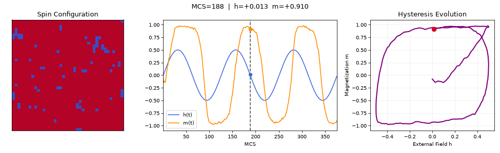
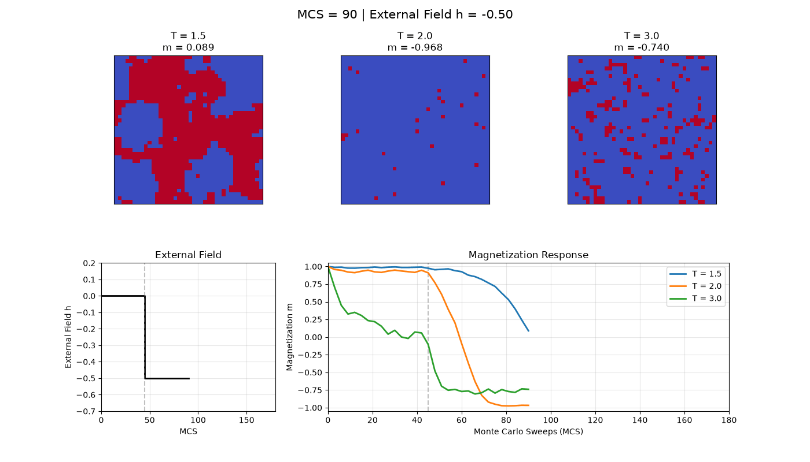
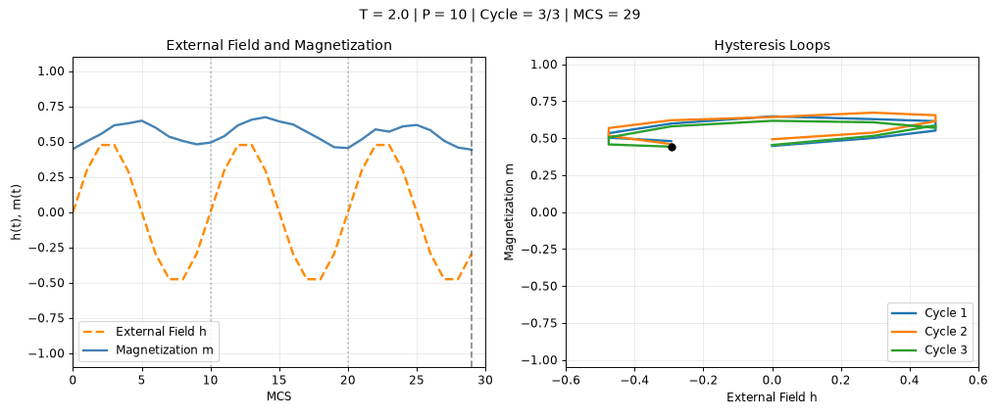
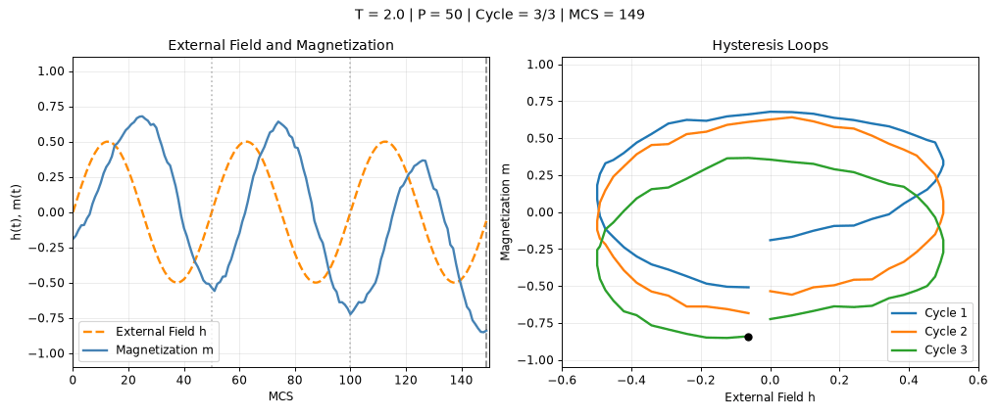
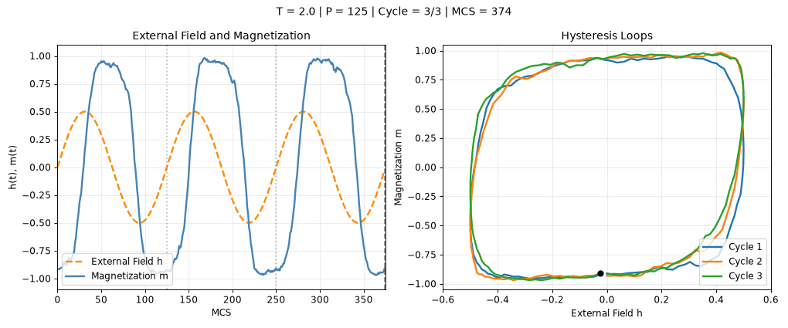
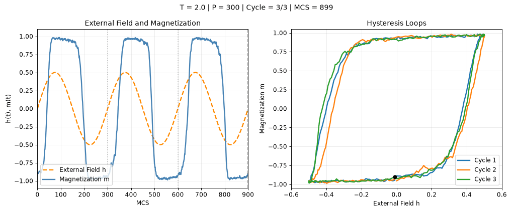
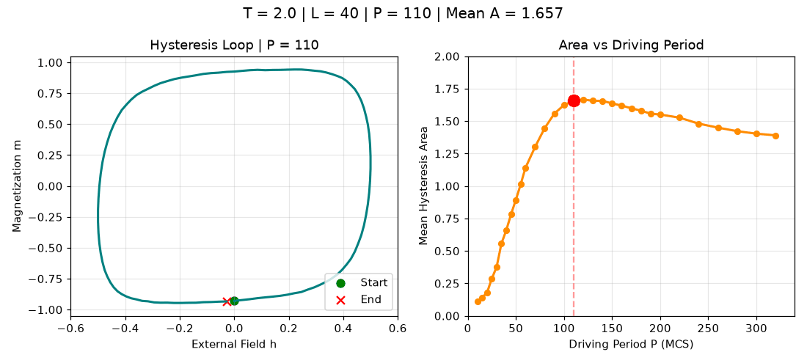
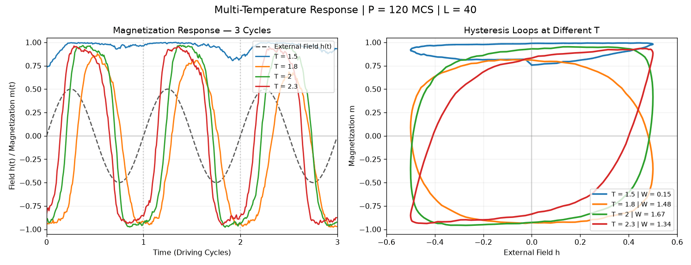

# Simulator Animation Gallery

**Click a thumbnail to open an individual animation page.** No Jupyter session is required. Each GIF can also be previewed or downloaded separately.

These eight GIFs were exported from an earlier state of the Simulator notebook and cover five types of dynamic display. The four period options in the multi-cycle hysteresis demo are exported individually. Static thumbnails keep the gallery lightweight.

| Animation | Preview | GIF file |
|---|---|---|
| [Spin configuration, field, and hysteresis dynamics](spin_configuration_dynamics.md) | [](spin_configuration_dynamics.md) | [Open GIF](spin_configuration_dynamics.gif) |
| [Temperature and field-step response](temperature_field_response.md) | [](temperature_field_response.md) | [Open GIF](temperature_field_response.gif) |
| [Three-cycle hysteresis: P=10](multi_cycle_hysteresis_P10.md) | [](multi_cycle_hysteresis_P10.md) | [Open GIF](multi_cycle_hysteresis_P10.gif) |
| [Three-cycle hysteresis: P=50](multi_cycle_hysteresis_P50.md) | [](multi_cycle_hysteresis_P50.md) | [Open GIF](multi_cycle_hysteresis_P50.gif) |
| [Three-cycle hysteresis: P=125](multi_cycle_hysteresis_P125.md) | [](multi_cycle_hysteresis_P125.md) | [Open GIF](multi_cycle_hysteresis_P125.gif) |
| [Three-cycle hysteresis: P=300](multi_cycle_hysteresis_P300.md) | [](multi_cycle_hysteresis_P300.md) | [Open GIF](multi_cycle_hysteresis_P300.gif) |
| [Period sweep: loop shape and area](period_sweep_explorer.md) | [](period_sweep_explorer.md) | [Open GIF](period_sweep_explorer.gif) |
| [Multi-temperature response and period sweep](multi_temperature_period_explorer.md) | [](multi_temperature_period_explorer.md) | [Open GIF](multi_temperature_period_explorer.gif) |

## About the exports

- The temperature-response animation uses image frames already saved in the original notebook. GIF conversion changes the color palette and quantizes frame delays.
- The other animations were regenerated using the corresponding original computation and plotting cells, preserving their parameters and seeds. The spin demonstration also retains the existing snapshot recorder and consistency checks. No new Metropolis update algorithm was introduced.
- Interactive playback controls become automatically looping GIFs. GIFs do not retain sliders or checkboxes. The multi-temperature export uses the default selection of all temperatures; it does not enumerate every checkbox combination.
- Each frame in a period sweep represents a different driving period P, rather than the next time step of a single trajectory.
- The three earlier GIFs remain in the parent directory. Those older regenerated demonstrations are preserved separately from these exports of the complete Simulator notebook.

## Source and reproduction

The source cells used for these exports are archived in [source_cells.json](source_cells.json). Parameters, frame counts, and file hashes are recorded in [manifest.json](manifest.json). **The repository's main [Simulator notebook](../../../notebooks/Simulator.ipynb) has since been updated to the November 2026 25-cell version; these saved GIFs have not been regenerated from that latest notebook.** They remain qualitative demonstrations, not independent validation of the final paper's numerical statistics.

From the repository root, run:

```sh
python tools/export_notebook_gifs.py
```

By default, this redraws the seven code-based GIFs and retains the published temperature-response GIF. To extract the temperature-response frames again, use an **earlier saved-output notebook** containing the original HTML animation, because the current public notebook was committed with its generated outputs cleared:

```sh
python tools/export_notebook_gifs.py --notebook /path/to/Simulator.ipynb
```

The exporter does not run the full validation grid or modify existing research results.
