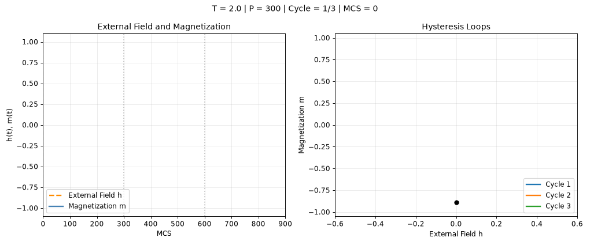

# Three-cycle hysteresis: P=300

[← Back to the gallery](README.md) · [Open or download GIF](multi_cycle_hysteresis_P300.gif)

L=40, T=2, h0=0.5, seed=101. Discards 15 driving cycles and displays the following three cycles.

This export illustrates the original notebook demonstration. It does not establish additional equilibration or convergence results.
