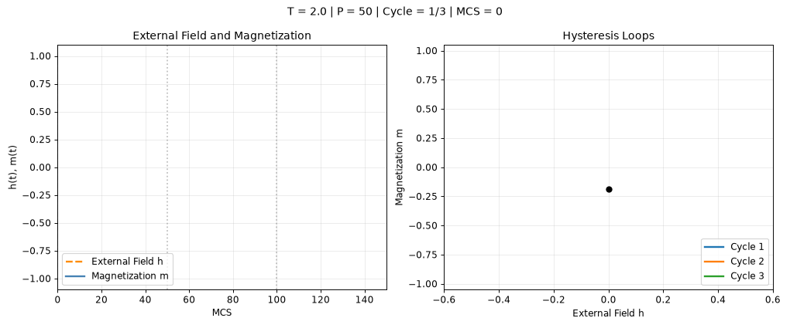

# 三周期磁滞：P=50

Three-cycle hysteresis: P=50

[← 返回动画图册](README.md) · [单独打开 / 下载 GIF](multi_cycle_hysteresis_P50.gif)

L=40, T=2, h0=0.5, seed=101；跳过 15 个周期，展示之后三个周期。

这是原 notebook 演示的导出版本，用于观看动态过程；不新增平衡或收敛结论。
