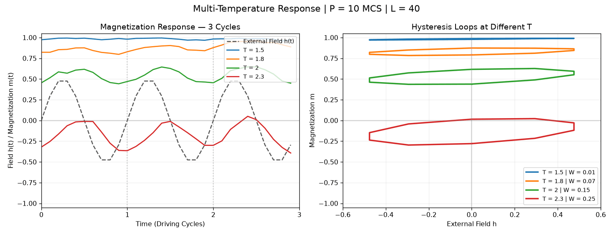

# 多温度比较与周期扫描

Multi-temperature period explorer

[← 返回动画图册](README.md) · [单独打开 / 下载 GIF](multi_temperature_period_explorer.gif)

按原来的 22 个周期选项自动播放，保留默认的全部温度选中状态：T=1.5、1.8、2.0、2.3。L=40, h0=0.5, seed=101；20 个周期、丢弃前 10 个；W 沿用原图的带符号场功定义。

这是原 notebook 演示的导出版本，用于观看动态过程；不新增平衡或收敛结论。
