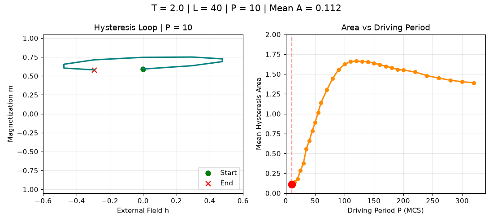

# 周期扫描：磁滞形状与面积

Period sweep explorer

[← 返回动画图册](README.md) · [单独打开 / 下载 GIF](period_sweep_explorer.gif)

按原来的 31 个周期选项自动播放；L=40, T=2, h0=0.5；seeds=101、202、303；每次 24 个周期，丢弃前 12 个。面积沿用原图的“相位平均回线的绝对梯形积分”，不是每周期绝对面积的平均值。

这是原 notebook 演示的导出版本，用于观看动态过程；不新增平衡或收敛结论。
