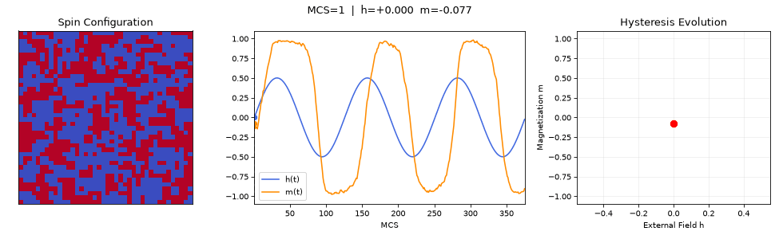

# 自旋构型、外场与磁滞同步演化

Spin configuration dynamics

[← 返回动画图册](README.md) · [单独打开 / 下载 GIF](spin_configuration_dynamics.gif)

L=40, T=2, h0=0.5, P=125, seed=42；展示最初三个周期，包含初始过渡过程。原有快照记录器的轨迹一致性检查已执行。

这是原 notebook 演示的导出版本，用于观看动态过程；不新增平衡或收敛结论。
