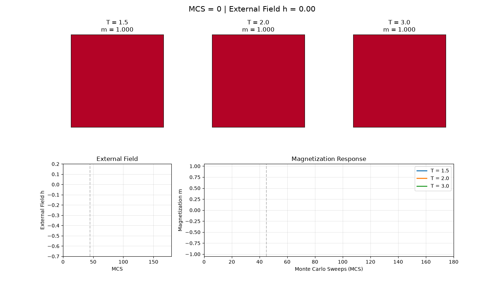

# 温度与阶跃外场响应

Temperature and field-step response

[← 返回动画图册](README.md) · [单独打开 / 下载 GIF](temperature_field_response.gif)

L=40；T=1.5、2.0、3.0。外场在 MCS=45 从 0 切换为 −0.5。直接转换原 notebook 已保存的 61 帧，没有重新生成这段随机轨迹。

这是原 notebook 演示的导出版本，用于观看动态过程；不新增平衡或收敛结论。
