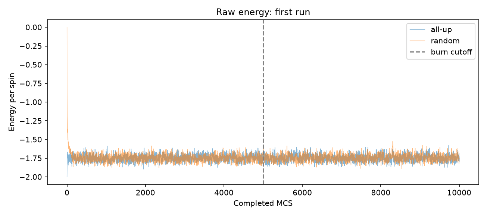
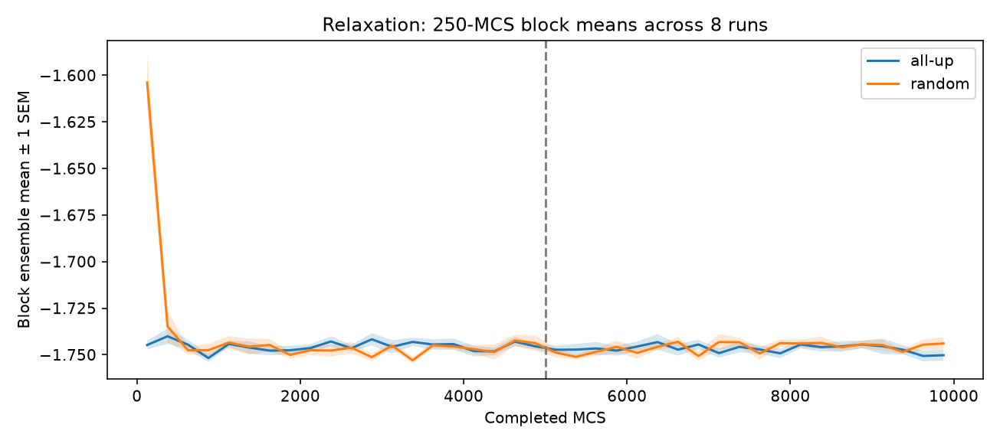
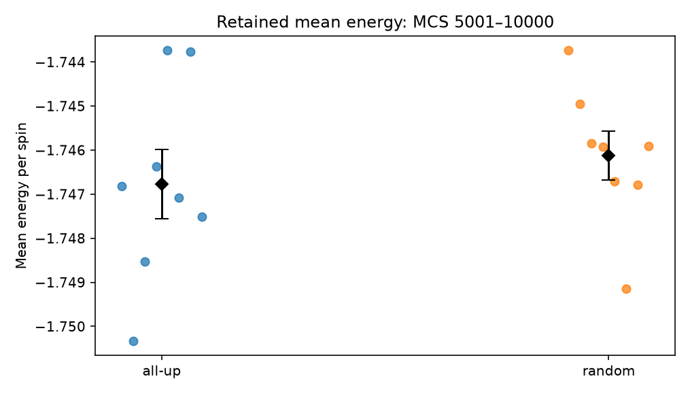
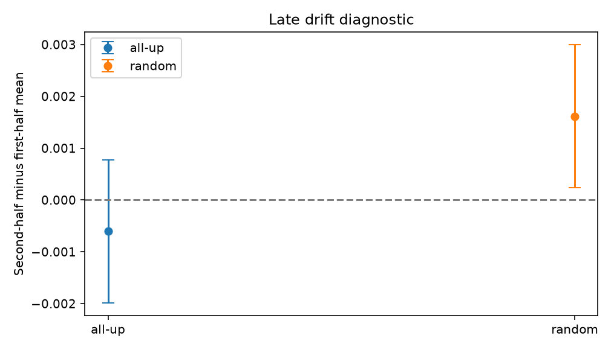

# Draft — Numerical Validation, Part 1

*Working text from the research-note drafting process. Figures and conclusions are preliminary; text has not undergone final scientific review.*

## Equilibration and Initial-State Independence

### Figure 1 — Raw Energy

For the given conditions, L = 40 and T = 2, we found that the energy per spin approaches a similar range regardless of whether the initial state is random or all-up. However, the two initial states show different relaxation behaviors: the energy of the random configuration decreases, while the energy of the all-up configuration increases from its initially ordered state.

After a sufficiently long time, both systems fluctuate around approximately the same mean energy due to thermal fluctuations. We choose a burn-in cutoff of 5000 MCS, meaning that the first 5000 sweeps are discarded when calculating the equilibrium averages.

### Figure 2 — Ensemble Relaxation

This is an averaged version of the first graph, using 250-MCS blocks and 8 independent runs for each initial state to reduce the influence of random fluctuations in a single simulation.

We can see that the results are consistent with our observation in the first graph. Although the two initial states have different relaxation behaviors at the beginning, their average energies eventually approach the same range and remain relatively stable afterward.

This provides further evidence that the energy of the system becomes less dependent on its initial configuration after sufficient equilibration.

### Figure 3 — Retained Mean Energy

The next test is to compare the mean energy obtained from each independent trial after the burn-in period.

For each run, we calculate the average energy per spin using the data from MCS 5001 to 10000. We then compare the results from the all-up and random initial states.

We find that the mean energies from the two groups are very close, approximately −1.7468 for the all-up state and −1.7463 for the random state. The difference between the two group means is small compared with their statistical uncertainties.

This suggests that, under the given conditions, the equilibrium mean energy is consistent between the two initial states.

### Figure 4 — Late-Time Drift

We also want to make sure that the mean energy does not continue to change systematically after the system appears to have reached equilibrium.

Otherwise, even if the mean energies from different initial states are consistent, both groups might still be undergoing a slow relaxation process.

To check this, we divide the retained data into two parts, MCS 5001–7500 and MCS 7501–10000, and calculate the difference between their mean energies:

`D = 〈e〉second half − 〈e〉first half`

If the energy statistics are stable, we expect this difference to be close to zero within statistical uncertainties.

We can see from the graph that the results for both initial states are consistent with zero drift within their uncertainties. This suggests that there is no statistically detectable systematic change in the mean energy during the retained measurement period.

### Conclusion

Together, these tests provide evidence that, for L = 40 and T = 2, the energy statistics become largely independent of the initial configuration after sufficient Monte Carlo sweeps. The retained mean energies are consistent between the two initial states, and no significant late-time drift is detected.

However, these results only support the equilibration of the energy observable under the tested conditions. Further tests are needed to examine other temperatures, lattice sizes, and observables, and to verify that the equilibrium statistics agree with the Boltzmann distribution.
